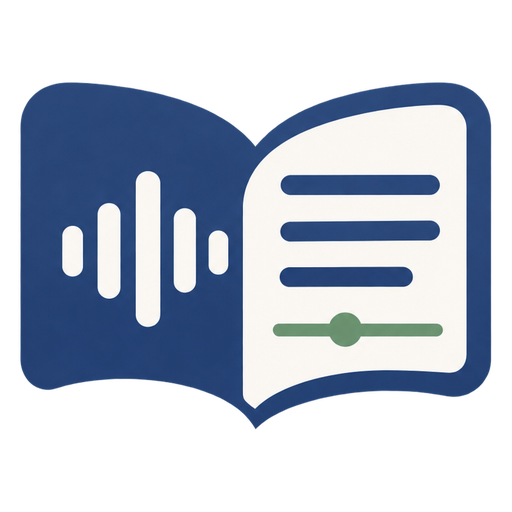
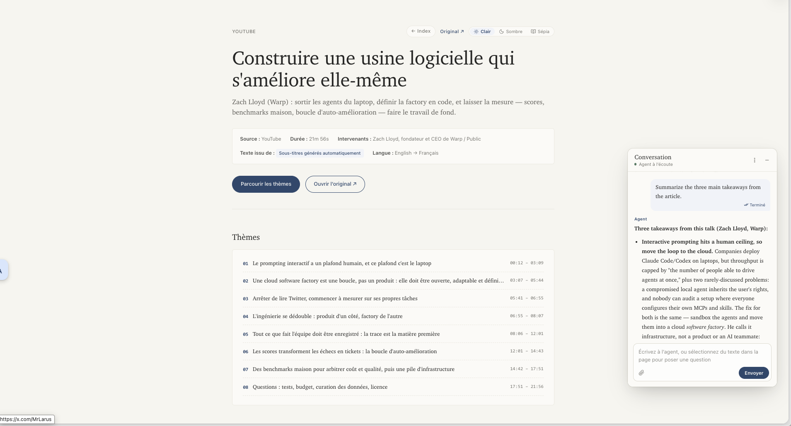
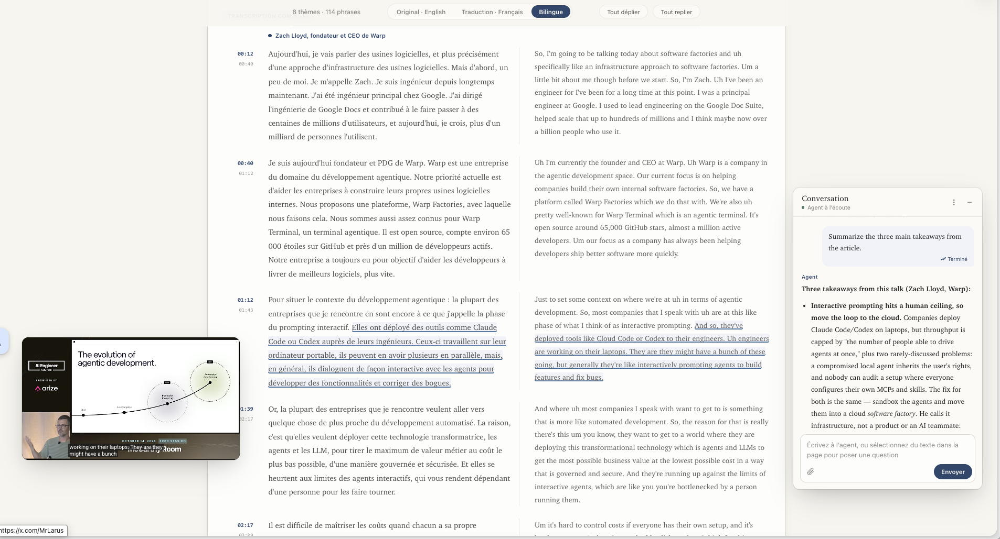
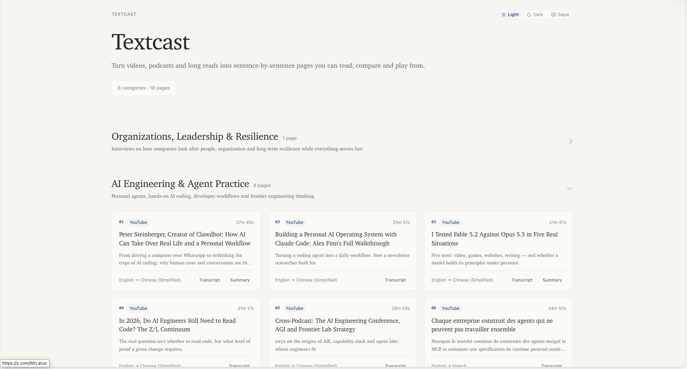

<div align="center">
  
  <h1>Textcast</h1>
  <p><strong>ポッドキャストや動画を、観る代わりに読む。読みながらエージェントと話せます。</strong></p>
  <p>
    <a href="LICENSE"></a>
    <a href="https://github.com/veardk/textcast/releases"></a>
    <a href="https://github.com/veardk/textcast/stargazers"></a>
    <a href="#インストール"></a>
  </p>
  <p><a href="README.md">English</a> · <a href="README.zh-CN.md">简体中文</a> · <a href="README.zh-TW.md">繁體中文</a> · <strong>日本語</strong> · <a href="README.ko.md">한국어</a> · <a href="README.es.md">Español</a> · <a href="README.fr.md">Français</a> · <a href="README.de.md">Deutsch</a></p>
</div>

<p align="center">
  
</p>
<p align="center">
   
</p>

Textcast は、ポッドキャストや動画を本当に読めるテキストに変えます。全文の書き起こしをあなたの言語に翻訳し、トピックごとに整理して解説を添え、ひとつの閲覧ページにまとめます。1 時間の音声をシークバーで行き来する代わりに、自分のペースで読めます。

ページは生きています。閲覧ウィンドウで開き、すぐ横にエージェントがいます。どの文でも選択すれば質問でき、修正も頼めます。エージェントは答え、読んでいる最中にページを更新します。どの行をクリックしても、その瞬間から小さなフローティングプレーヤーで動画が再生されるので、実際の話し方をいつでも確かめられます。

長い記事や文書にも使えます。Textcast は Agent Skill です。読むのも翻訳するのもエージェント自身で、字幕・タイミング・チェックはスクリプトが担当するため、要約で省かれる行はひとつもありません。

## インストール

エージェントごとに方法をひとつ選んでください。同じ Skill を 2 回入れると（たとえばプラグインと `npx skills` の両方）、エージェントには 2 つ見えてしまいます。

### どのエージェントでも（おすすめ）

```bash
npx skills@latest add veardk/textcast -g
```

`-g` はユーザー単位でインストールするので、どのフォルダでも使えます。`-a <agent>` を付けるとエージェントを最初から指定でき（`claude-code`、`codex`、`cursor`、`opencode`、`windsurf` など）、省略すると一覧から選べます。更新は `npx skills@latest update textcast` です。

<details>
<summary><strong>Claude Code</strong>（プラグイン）</summary>

```bash
claude plugin marketplace add veardk/textcast
claude plugin install textcast@veardk
```

更新するには `claude plugin marketplace update veardk` を実行してから `claude plugin update textcast@veardk` を実行します。

</details>

<details>
<summary><strong>Codex</strong>（プラグイン）</summary>

```bash
codex plugin marketplace add veardk/textcast
codex plugin add textcast@veardk
```

起動時に自動で更新されます。

</details>

<details>
<summary><strong>GitHub Copilot</strong>（CLI と VS Code）</summary>

```bash
copilot plugin marketplace add veardk/textcast
copilot plugin install textcast@veardk
```

VS Code では **Chat: Install Plugin From Source** を実行し、`https://github.com/veardk/textcast` を入力します。

</details>

<details>
<summary><strong>Gemini CLI</strong></summary>

```bash
gemini skills install https://github.com/veardk/textcast.git --path skills/textcast
```

もう一度実行すると更新されます。

</details>

<details>
<summary><strong>手動</strong>（git clone）</summary>

リポジトリをクローンし、中の Skill フォルダをエージェントの skills フォルダにコピーします。Claude Code の場合：

```bash
git clone https://github.com/veardk/textcast.git
cp -R textcast/skills/textcast ~/.claude/skills/
```

更新するには、もう一度 pull してコピーします。

</details>

## 使い方

エージェントにこう頼みます：

> /textcast https://www.youtube.com/watch?v=…

> https://www.youtube.com/watch?v=… を日本語の Textcast ページにして。

エージェントが内容を取得し、翻訳し、トピックに分け、ページを公開して閲覧ウィンドウで開きます。どの文についても質問できます。

## 機能

- **観る代わりに読む**：YouTube や Bilibili のポッドキャスト・動画の全文書き起こし。すべての行を順番どおりに、ひとつも省かずに。
- **あなたの言語で**：原文、訳文、左右の対訳表示。翻訳はエージェントが行います。
- **読みながら話す**：ページは閲覧ウィンドウ（[textcast-chat-axi](https://github.com/veardk/textcast-chat-axi)）で開き、リアルタイムの会話パネルが付きます。テキストを選択してエージェントに質問したり修正を頼んだりすると、ページがその場で更新されます。
- **フローティング動画プレーヤー**：どの行をクリックしても、本文の横の小さなウィンドウでその瞬間から動画が再生されます。聞きながら読み続けられます。
- **トピックと解説**：書き起こしはトピックカードに分かれ、それぞれにエージェントの解説が付きます。要約ページも作れます。
- **信頼できるタイムスタンプ**：時刻はすべて字幕から取り、推測はしません。
- **長いテキストにも**：字幕ファイル（`.srt`、`.vtt`、`.json`）、Markdown やテキスト、PDF やウェブページから抜き出したテキスト。
- **自分だけのライブラリ**：ページはカテゴリごとに整理され、インデックスページが付きます。ライト・ダーク・セピアのテーマ、17 言語の表示に対応。

## ページの保存先

ページはエージェントを実行したフォルダの `./textcast/output/` に書き出されます。skill フォルダには書きません：

```text
textcast/output/
├── index.html                      # ライブラリ
├── <category>/NN-<slug>.html       # 書き起こしページ
├── <category>/NN-<slug>-summary.html
└── .work/                          # 中間ファイル（字幕、翻訳）
```

どのページも単体の HTML ファイルで、直接開いても使えます。

## 必要なもの

- Python 3.10 以降（標準ライブラリのみ）
- Node.js 22 以降。字幕の取得と閲覧ウィンドウに使います（初回に `npx` がダウンロードします）
- `yt-dlp`（任意）。YouTube の字幕取得に失敗したとき自動で使われます
- Bilibili の字幕にはログインが必要です。ブラウザから cookie を読み取るか QR ログインを行い、`~/.textcast/` に保存します。

ローカルの音声・動画の文字起こしにはまだ対応していません。その場合は字幕ファイルを用意してください。

## フィードバック

バグやアイデアは [issue](https://github.com/veardk/textcast/issues) へどうぞ。閲覧ウィンドウそのものの問題は [textcast-chat-axi](https://github.com/veardk/textcast-chat-axi/issues) へお願いします。

## 謝辞

ページのデザインと配色は [Kami](https://github.com/tw93/Kami) を参考にしています。

## ライセンス

[MIT](LICENSE)
