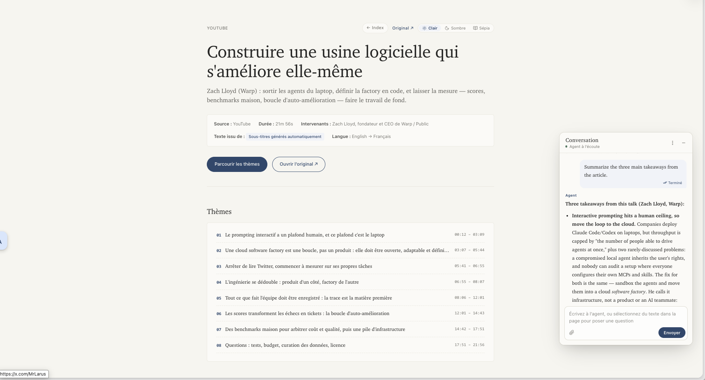
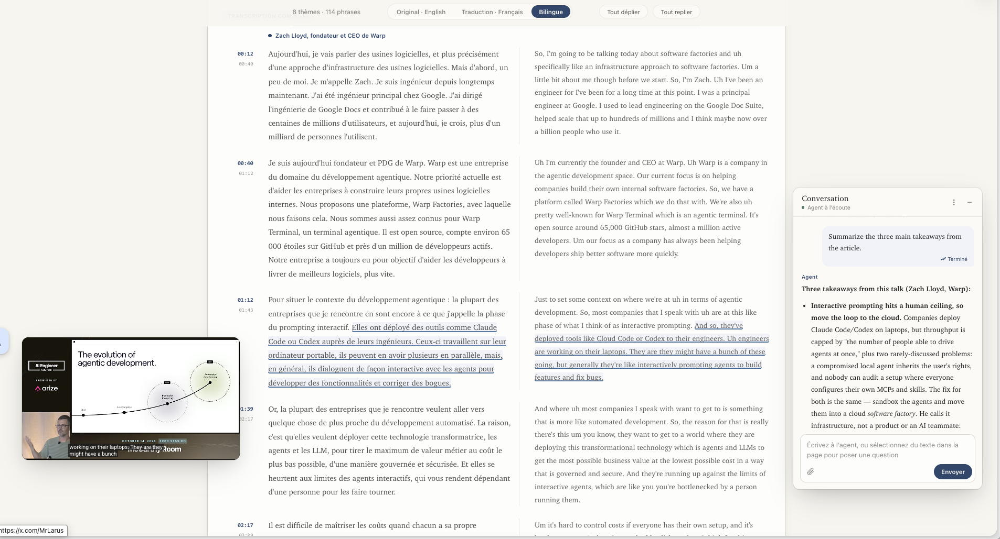
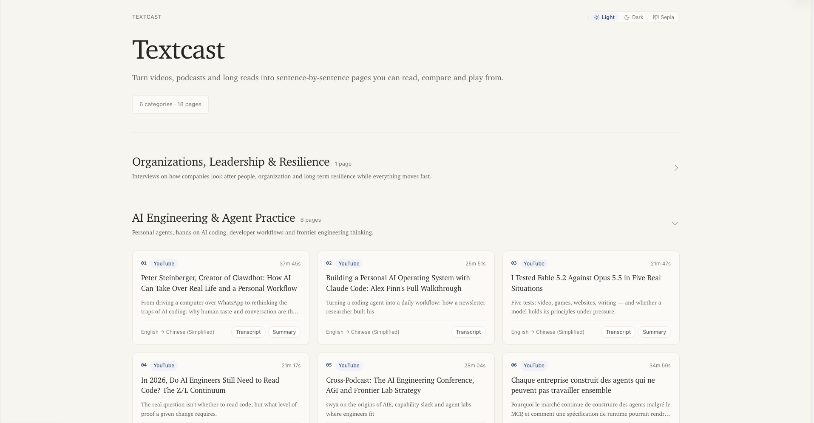

<div align="center">
  
  <h1>Textcast</h1>
  <p><strong>팟캐스트와 동영상을 보는 대신 읽고, 읽으면서 에이전트와 대화하세요.</strong></p>
  <p>
    <a href="LICENSE"></a>
    <a href="https://github.com/veardk/textcast/releases"></a>
    <a href="https://github.com/veardk/textcast/stargazers"></a>
    <a href="#설치"></a>
  </p>
  <p><a href="README.md">English</a> · <a href="README.zh-CN.md">简体中文</a> · <a href="README.zh-TW.md">繁體中文</a> · <a href="README.ja.md">日本語</a> · <strong>한국어</strong> · <a href="README.es.md">Español</a> · <a href="README.fr.md">Français</a> · <a href="README.de.md">Deutsch</a></p>
</div>

<p align="center">
  
</p>
<table align="center">
  <tr>
    <td align="center"></td>
    <td align="center"></td>
  </tr>
</table>

Textcast는 팟캐스트나 동영상을 제대로 읽을 수 있는 글로 바꿔 줍니다. 전체 스크립트를 내 언어로 번역하고, 주제별로 정리해 해설을 붙여 하나의 읽기 페이지에 담습니다. 한 시간짜리 오디오를 앞뒤로 넘겨 가며 찾는 대신, 내 속도대로 읽으면 됩니다.

페이지는 살아 있습니다. 읽기 창에서 열리고 바로 옆에 에이전트가 있습니다. 아무 문장이나 선택해 질문하거나 수정을 요청하면, 에이전트가 답하고 읽는 동안 페이지를 바로 고칩니다. 아무 줄이나 클릭하면 작은 플로팅 플레이어에서 그 순간부터 동영상이 재생되어, 원래 어떻게 말했는지 언제든 들어 볼 수 있습니다.

긴 글과 문서에도 쓸 수 있습니다. Textcast는 Agent Skill입니다. 읽기와 번역은 에이전트가 직접 하고, 자막·타이밍·검사는 스크립트가 맡기 때문에 요약으로 빠지는 줄이 하나도 없습니다.

## 설치

에이전트마다 한 가지 방법만 고르세요. 같은 Skill을 두 번 설치하면(예: 플러그인과 `npx skills` 둘 다) 에이전트에 두 개가 보입니다.

### 모든 에이전트 (추천)

```bash
npx skills@latest add veardk/textcast -g
```

`-g`는 사용자 단위로 설치하므로 어느 폴더에서나 쓸 수 있습니다. `-a <agent>`를 붙이면 에이전트를 바로 지정할 수 있고(`claude-code`, `codex`, `cursor`, `opencode`, `windsurf` 등), 생략하면 목록에서 고릅니다. 업데이트는 `npx skills@latest update textcast`입니다.

<details>
<summary><strong>Claude Code</strong> (플러그인)</summary>

```bash
claude plugin marketplace add veardk/textcast
claude plugin install textcast@veardk
```

업데이트하려면 `claude plugin marketplace update veardk`를 실행한 뒤 `claude plugin update textcast@veardk`를 실행하세요.

</details>

<details>
<summary><strong>Codex</strong> (플러그인)</summary>

```bash
codex plugin marketplace add veardk/textcast
codex plugin add textcast@veardk
```

시작할 때 자동으로 업데이트됩니다.

</details>

<details>
<summary><strong>GitHub Copilot</strong> (CLI 및 VS Code)</summary>

```bash
copilot plugin marketplace add veardk/textcast
copilot plugin install textcast@veardk
```

VS Code에서는 **Chat: Install Plugin From Source**를 실행하고 `https://github.com/veardk/textcast`를 입력하세요.

</details>

<details>
<summary><strong>Gemini CLI</strong></summary>

```bash
gemini skills install https://github.com/veardk/textcast.git --path skills/textcast
```

다시 실행하면 업데이트됩니다.

</details>

<details>
<summary><strong>수동 설치</strong> (git clone)</summary>

저장소를 클론한 뒤 그 안의 Skill 폴더를 에이전트의 skills 폴더에 복사하세요. Claude Code의 경우:

```bash
git clone https://github.com/veardk/textcast.git
cp -R textcast/skills/textcast ~/.claude/skills/
```

업데이트하려면 다시 pull한 뒤 복사하세요.

</details>

## 사용법

에이전트에게 이렇게 요청하세요:

> /textcast https://www.youtube.com/watch?v=…

> https://www.youtube.com/watch?v=… 를 한국어 Textcast 페이지로 만들어 줘.

에이전트가 내용을 가져와 번역하고, 주제별로 나누고, 페이지를 게시한 뒤 읽기 창에서 엽니다. 어떤 문장에 대해서든 질문할 수 있습니다.

## 기능

- **보는 대신 읽기**: YouTube나 Bilibili 팟캐스트·동영상의 전체 스크립트. 모든 줄을 순서대로, 하나도 빠짐없이.
- **내 언어로**: 원문, 번역문, 좌우 대역 보기. 번역은 에이전트가 합니다.
- **읽으면서 대화**: 페이지는 읽기 창([textcast-chat-axi](https://github.com/veardk/textcast-chat-axi))에서 열리고 실시간 대화 패널이 함께 있습니다. 텍스트를 선택해 에이전트에게 질문하거나 수정을 요청하면 페이지가 그 자리에서 바뀝니다.
- **플로팅 동영상 플레이어**: 아무 줄이나 클릭하면 본문 옆 작은 창에서 그 순간부터 동영상이 재생됩니다. 들으면서 계속 읽을 수 있습니다.
- **주제와 해설**: 스크립트는 주제 카드로 나뉘고 카드마다 에이전트의 설명이 붙습니다. 요약 페이지도 만들 수 있습니다.
- **믿을 수 있는 타임스탬프**: 모든 시간은 자막에서 가져오며 추측하지 않습니다.
- **긴 글도 가능**: 자막 파일(`.srt`, `.vtt`, `.json`), Markdown이나 텍스트, PDF나 웹 페이지에서 뽑은 텍스트.
- **나만의 라이브러리**: 페이지는 카테고리별로 정리되고 색인 페이지가 있습니다. 라이트·다크·세피아 테마, 17개 언어 표시를 지원합니다.

## 페이지 저장 위치

페이지는 에이전트를 실행한 폴더의 `./textcast/output/`에 저장됩니다. skill 폴더에는 저장하지 않습니다:

```text
textcast/output/
├── index.html                      # 라이브러리
├── <category>/NN-<slug>.html       # 스크립트 페이지
├── <category>/NN-<slug>-summary.html
└── .work/                          # 중간 파일 (자막, 번역)
```

모든 페이지는 하나의 HTML 파일이며, 직접 열어도 동작합니다.

## 요구 사항

- Python 3.10 이상 (표준 라이브러리만 사용)
- Node.js 22 이상. 자막 가져오기와 읽기 창에 쓰입니다 (처음 사용할 때 `npx`가 내려받습니다)
- `yt-dlp` (선택). YouTube 자막 가져오기가 실패하면 자동으로 사용됩니다
- Bilibili 자막은 로그인이 필요합니다. 브라우저에서 cookie를 읽거나 QR 로그인을 제공하며, `~/.textcast/`에 저장합니다.

로컬 오디오·동영상의 음성 인식은 아직 지원하지 않습니다. 이런 파일은 자막 파일을 준비해 주세요.

## 피드백

버그나 아이디어는 [issue](https://github.com/veardk/textcast/issues)로 남겨 주세요. 읽기 창 자체의 문제는 [textcast-chat-axi](https://github.com/veardk/textcast-chat-axi/issues)에 올려 주세요.

## 감사의 말

페이지 디자인과 색상은 [Kami](https://github.com/tw93/Kami)를 참고했습니다.

## 라이선스

[MIT](LICENSE)
