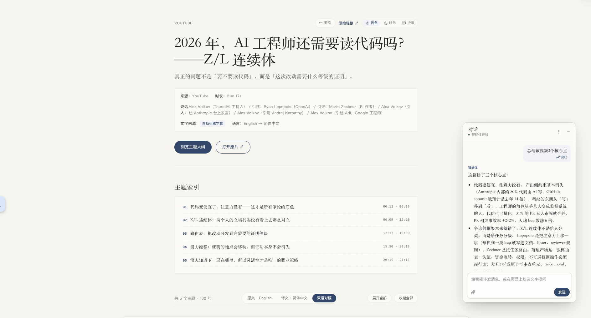
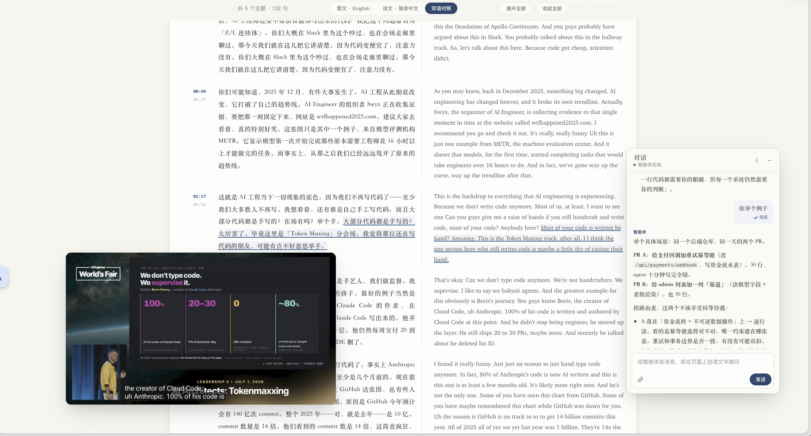
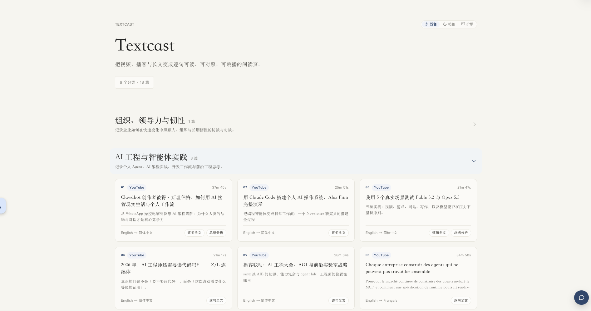

<div align="center">
  
  <h1>Textcast</h1>
  <p><strong>把播客和视频变成可以读的文字，边读边和你的 agent 对话。</strong></p>
  <p>
    <a href="LICENSE"></a>
    <a href="https://github.com/veardk/textcast/releases"></a>
    <a href="https://github.com/veardk/textcast/stargazers"></a>
    <a href="#安装"></a>
  </p>
  <p><a href="README.md">English</a> · <strong>简体中文</strong> · <a href="README.zh-TW.md">繁體中文</a> · <a href="README.ja.md">日本語</a> · <a href="README.ko.md">한국어</a> · <a href="README.es.md">Español</a> · <a href="README.fr.md">Français</a> · <a href="README.de.md">Deutsch</a></p>
</div>

<p align="center">
  
</p>
<table align="center">
  <tr>
    <td align="center"></td>
    <td align="center"></td>
  </tr>
</table>

Textcast 把一期播客或一个视频变成真正能读的文字：完整的逐字稿，翻译成你的语言，按话题整理并附上解读，全部放在一个阅读页面里。你可以按自己的节奏读，不用在一小时的音频里来回拖进度条。

页面是“活”的。它在阅读窗口中打开，你的 agent 就在旁边：选中任意一句话就能提问，或者让它修改，agent 会回答并在你阅读时直接更新页面。点击任意一行，视频会在小窗里从那一刻开始播放，随时能听到原话是怎么说的。

长文章和文档也同样适用。Textcast 是一个 Agent Skill：由你的 agent 亲自阅读和翻译，脚本负责字幕、时间轴和检查，所以没有一句话会被概括掉。

## 安装

每个 agent 选一种方式即可。同一个 Skill 装两次（比如既装插件又用 `npx skills` 安装），agent 会看到两份。

### 任意 agent（推荐）

```bash
npx skills@latest add veardk/textcast -g
```

`-g` 表示为当前用户安装，在任何文件夹都能用。加上 `-a <agent>` 可以直接指定 agent（`claude-code`、`codex`、`cursor`、`opencode`、`windsurf` 等），不加则从列表中选择。更新请运行 `npx skills@latest update textcast`。

<details>
<summary><strong>Claude Code</strong>（插件）</summary>

```bash
claude plugin marketplace add veardk/textcast
claude plugin install textcast@veardk
```

更新时先运行 `claude plugin marketplace update veardk`，再运行 `claude plugin update textcast@veardk`。

</details>

<details>
<summary><strong>Codex</strong>（插件）</summary>

```bash
codex plugin marketplace add veardk/textcast
codex plugin add textcast@veardk
```

启动时自动更新。

</details>

<details>
<summary><strong>GitHub Copilot</strong>（CLI 和 VS Code）</summary>

```bash
copilot plugin marketplace add veardk/textcast
copilot plugin install textcast@veardk
```

在 VS Code 中运行 **Chat: Install Plugin From Source**，输入 `https://github.com/veardk/textcast`。

</details>

<details>
<summary><strong>Gemini CLI</strong></summary>

```bash
gemini skills install https://github.com/veardk/textcast.git --path skills/textcast
```

再运行一次即可更新。

</details>

<details>
<summary><strong>手动安装</strong>（git clone）</summary>

克隆仓库，再把其中的 Skill 文件夹复制到 agent 的 skills 文件夹。以 Claude Code 为例：

```bash
git clone https://github.com/veardk/textcast.git
cp -R textcast/skills/textcast ~/.claude/skills/
```

更新时重新拉取并复制一次。

</details>

## 使用

对你的 agent 说，例如：

> /textcast https://www.youtube.com/watch?v=…

> 把 https://www.youtube.com/watch?v=… 做成中文的 Textcast 页面。

agent 会获取内容、翻译、按话题整理、发布页面，然后在阅读窗口中打开，你可以就任意一句话提问。

## 功能

- **读代替看**：YouTube 或 B 站播客、视频的完整逐字稿，每一行按顺序呈现，一句不漏。
- **你的语言**：原文、译文或左右双语对照阅读，由你的 agent 翻译。
- **边读边聊**：页面在阅读窗口（[textcast-chat-axi](https://github.com/veardk/textcast-chat-axi)）中打开，旁边是实时对话面板。选中任意文字即可向 agent 提问或要求修改，页面会就地更新。
- **小窗视频播放**：点击任意一行，视频就在正文旁的小窗里从那一刻开始播放，可以边听边继续读。
- **话题与解读**：逐字稿按话题分成卡片，每张都有 agent 的讲解，还可以生成一页摘要。
- **可信的时间戳**：每个时间都来自字幕，从不猜测。
- **也支持任意长文本**：字幕文件（`.srt`、`.vtt`、`.json`）、Markdown 或纯文本，以及从 PDF 或网页提取的文字。
- **你自己的文库**：页面按分类整理，带一个首页；支持浅色、深色、护眼三种主题，界面文字支持 17 种语言。

## 页面保存在哪里

页面保存在你运行 agent 的那个文件夹下的 `./textcast/output/`，而不是 skill 文件夹里：

```text
textcast/output/
├── index.html                      # 文库首页
├── <category>/NN-<slug>.html       # 逐字稿页面
├── <category>/NN-<slug>-summary.html
└── .work/                          # 中间文件（字幕、译文）
```

每个页面都是一个独立的 HTML 文件，直接打开也能用。

## 环境要求

- Python 3.10 或更高版本（只用标准库）
- Node.js 22 或更高版本，用于获取字幕和阅读窗口（首次使用时由 `npx` 自动下载）
- `yt-dlp`（可选），YouTube 字幕获取失败时自动使用
- B 站字幕需要登录。脚本会从浏览器读取 cookie，或提供扫码登录，cookie 保存在 `~/.textcast/`。

暂不支持本地音频或视频转写。这类文件请提供字幕文件。

## 反馈

有 bug 或想法，欢迎提交 [issue](https://github.com/veardk/textcast/issues)。阅读窗口本身的问题请提到 [textcast-chat-axi](https://github.com/veardk/textcast-chat-axi/issues)。

## 致谢

页面设计和配色参考了 [Kami](https://github.com/tw93/Kami)。

## 许可证

[MIT](LICENSE)
